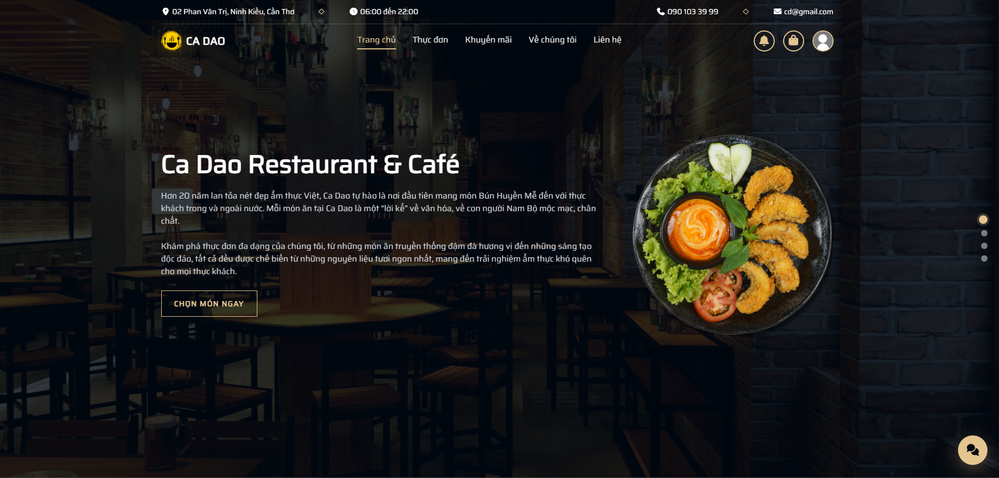
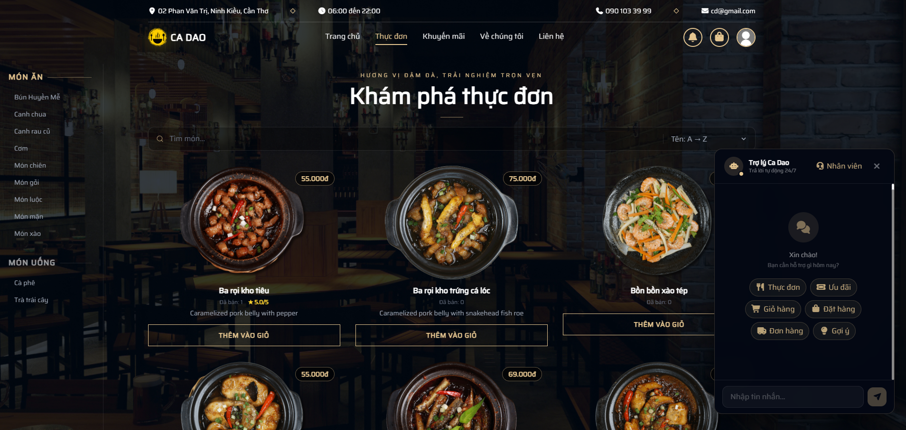

<div align="center">


# Ca Dao: Hệ thống đặt món & quản lý nhà hàng

Nền tảng full-stack cho nhà hàng: khách đặt món và thanh toán online, nhân viên xử lý đơn theo thời gian thực và chatbot AI hỗ trợ đặt món.

[](https://ca-dao.onrender.com/)


</div>

---

## Demo

**https://ca-dao.onrender.com/**

| Vai trò | Trang đăng nhập | Tài khoản | Mật khẩu |
|---|---|---|---|
| Quản trị viên | [`/admin/login`](https://ca-dao.onrender.com/admin/login) | `admin` | `Admin@123` |
| Khách hàng | [`/auth/login`](https://ca-dao.onrender.com/auth/login) | `user@gmail.com` | `User@123` |

<p align="center">
  
  <br/><em>Trang chủ</em>
</p>

<p align="center">
  
  <br/><em>Thực đơn kèm chatbot AI hỗ trợ đặt món</em>
</p>

---

## Tính năng chính

### Khách hàng
- Duyệt thực đơn theo loại, danh mục và khoảng giá, kèm tìm kiếm và lọc món.
- Giỏ hàng, mã giảm giá (voucher) và chương trình khuyến mãi áp dụng theo món, danh mục hoặc loại thực đơn.
- Thanh toán online qua **VNPAY** hoặc thanh toán khi nhận hàng (COD).
- Theo dõi trạng thái đơn **theo thời gian thực**: `pending → confirmed → preparing → shipping → completed`.
- Đánh giá đơn hàng và từng món, gửi góp ý, nhận thông báo đẩy.
- **Chatbot AI** có thể tìm món, xem khuyến mãi, thêm/sửa/xoá món trong giỏ, tra cứu đơn và đặt hàng ngay trong khung chat.

### Quản trị & nhân viên
- **Dashboard & thống kê**: doanh thu, đơn hàng, món bán chạy (biểu đồ Recharts), xuất báo cáo PDF.
- Quản lý thực đơn, danh mục, loại món (ảnh lưu trên Cloudinary).
- Quản lý đơn hàng: xác nhận, chuyển trạng thái, phân công shipper. Đơn mới được báo ngay qua Socket.IO.
- Quản lý khách hàng, nhân viên, khu vực giao hàng (phường), voucher, khuyến mãi, đánh giá và góp ý.
- **Chat trực tiếp với khách**: admin xem hội thoại realtime và có thể tắt bot để tự trả lời.
- Phân quyền theo vai trò **admin / shipper**. Shipper có trang riêng để nhận và cập nhật đơn được giao.

---

## Điểm nhấn kỹ thuật

### Chatbot AI dùng function calling
Chatbot dùng OpenAI SDK (tương thích các nhà cung cấp OpenAI-compatible qua `OPENAI_BASE_URL`), với **12 tool** gọi thẳng vào tầng service của backend: `search_menu_items`, `filter_menu_items`, `get_menu_items_by_price`, `get_promotions`, `add_to_cart_item`, `update_cart_item`, `remove_cart_item`, `view_cart`, `get_delivery_info`, `place_order`, `get_order_history`, `track_orders`.

Bộ đánh giá tự động ([backend/evaluation](backend/evaluation)) chạy 50 test case với `gpt-4o-mini`:

| Chỉ số | Kết quả |
|---|---|
| Tỉ lệ phản hồi thành công | 100% |
| Độ chính xác chọn tool | 81% |
| Độ chính xác tham số | 98% |
| Độ trễ trung bình / P90 | 2.0 s / 3.0 s |
| Độ liên quan / chính xác của câu trả lời (thang 5) | 4.6 / 4.72 |

### Realtime với Socket.IO
Mỗi khách hàng, shipper, cuộc hội thoại và nhóm admin có room riêng. Các sự kiện `order:new`, `order:statusUpdated`, `order:assigned`, `notification:new` và `chat:newMessage` được đẩy ngay tới đúng người nhận, không cần tải lại trang.

### Kiến trúc backend phân lớp
`routes → controllers → services → repositories → PostgreSQL`, dùng SQL thuần qua `pg` (không ORM). Xác thực bằng JWT, mật khẩu băm bằng bcrypt, middleware phân quyền theo vai trò.

### Thử nghiệm: dự đoán thời gian giao hàng
Một module Python nhỏ trong [backend/ml](backend/ml) ước tính thời gian giao hàng từ các đặc trưng của đơn (khu vực, số món, giờ đặt, giá trị đơn). Mô hình Random Forest được huấn luyện trên dữ liệu đơn mẫu, sai số trung bình khoảng 8 phút. Đây là tính năng thử nghiệm; ứng dụng vẫn hoạt động đầy đủ khi không bật module này.

---

## Kiến trúc

```
┌────────────────────────┐   REST /api  ┌───────────────────────────┐      ┌──────────────┐
│  React 19 + Vite       │ ───────────▶ │  Node.js / Express 5      │ ───▶ │  PostgreSQL  │
│  Tailwind, Recharts    │ ◀─ Socket.IO │  JWT · Socket.IO · Multer │      └──────────────┘
└────────────────────────┘              │                           │ ───▶ Cloudinary (ảnh)
                                        │                           │ ───▶ VNPAY (thanh toán)
                                        │                           │ ───▶ OpenAI-compatible LLM
                                        └─────────────┬─────────────┘
                                                      │ HTTP :5050
                                        ┌─────────────▼─────────────┐
                                        │  ML service (thử nghiệm)  │
                                        │  Python / scikit-learn    │
                                        └───────────────────────────┘
```

Frontend được build tĩnh và Express phục vụ từ `backend/src/dist`, nên toàn bộ ứng dụng chạy trên một service duy nhất.

---

## Cấu trúc thư mục

```
CADAO-Manager/
├── backend/
│   ├── server.js              # HTTP server + khởi tạo Socket.IO
│   ├── init.sql               # Schema cơ sở dữ liệu (28 bảng)
│   ├── src/
│   │   ├── routes/            # Định nghĩa REST endpoint
│   │   ├── controllers/       # Xử lý request/response
│   │   ├── services/          # Nghiệp vụ (đơn hàng, khuyến mãi, chatbot…)
│   │   ├── repositories/      # Truy vấn SQL
│   │   ├── middlewares/       # Xác thực JWT, phân quyền
│   │   └── socket/            # Sự kiện realtime
│   ├── ml/                    # Thử nghiệm dự đoán thời gian giao hàng
│   ├── evaluation/            # Bộ đánh giá chatbot
│   └── scripts/               # Sinh dữ liệu đơn hàng mẫu
└── frontend/
    └── src/
        ├── pages/             # customer / admin / shipper / auth
        ├── components/
        ├── api/               # Axios client theo từng tài nguyên
        └── contexts/
```

---

## Công nghệ sử dụng

| Tầng | Công nghệ |
|---|---|
| Frontend | React 19, React Router 7, Vite 7, Tailwind CSS 4, Axios, Recharts, Socket.IO Client, jsPDF / pdfmake, AOS |
| Backend | Node.js, Express 5, PostgreSQL (`pg`), Socket.IO, JWT, bcrypt, Multer, Cloudinary |
| Tích hợp | VNPAY, OpenAI SDK (function calling) |
| Triển khai | Render |
